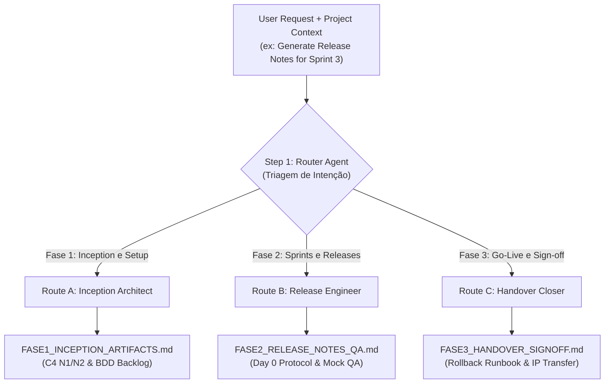

<div align="center">

# Technical Delivery Engine Plugin Plugin
### Event-Driven Router Pipeline for Software Engineering Artifacts & Handover

[](https://antigravity.google)
[](./LICENSE)
[](https://github.com/HalcyonTech-LTDA)

<p align="center">
  <b>Pipeline agêntico baseado em Router/Triagem On-Demand para geração dos Artefatos de Execução e Handover de Engenharia (C4 Model, Release Notes, QA Reports e Termo de Encerramento).</b>
</p>

</div>

---

## Installation & Verification

### Antigravity CLI (`agy`)

Install directly into your Antigravity environment via the CLI:

```bash
agy plugin install https://github.com/HalcyonTech-LTDA/technical-delivery-engine-plugin
```

Verify that the plugin is active and adheres to the strict official schema:

```bash
agy plugin list
agy plugin validate --strict ./technical-delivery-engine-plugin
```

---

## 1. Strategic Mission: The "Bloco 2" Execution Engine

If the **Contract Annexes Engine** builds the legal shields, the **Technical Delivery Engine** is the machinery that makes those shields work in the trenches.

This plugin ensures that the engineering team delivers professional, highly standardized artifacts throughout the software development lifecycle. By treating engineering documentation as an event-driven flow, we eliminate "zombie projects" and unstructured communication, ensuring the client receives what they paid for while the software house remains protected against undue liability.

---

---

## 2. The 3 Phases of Technical Delivery

Because delivery artifacts are generated months apart, this plugin organizes them into three distinct temporal phases:

### Phase 1: Inception & Setup Estrutural (Sprint 0 / M0)
- **Artifacts:** C4 Model Diagrams (Context N1 & Containers N2 in Mermaid), Infrastructure & RACI Matrix, CI/CD Pipeline Setup with Staging Health Check, and Refined Sprint 1 Backlog with BDD Acceptance Criteria.
- **Goal:** Materialize the architectural baseline and prove to the client's CTO that the foundation is sound before business logic is written, establishing clear Schedule Freeze triggers.

### Phase 2: Construção, QA & Entrega Contínua (Sprints / Marcos M1..Mn)
- **Artifacts:** Formal UAT Protocol (Day 0 trigger for the 5-day Tacit Acceptance Window), Release Notes (with explicit Known Issues), OpenAPI/Swagger specs with executable cURLs, and QA Reports.
- **Goal:** Formally trigger the **5-day Tacit Acceptance Window**. Crucially, this phase demands evidence of mock-based CI/CD testing, proving the software house's deliverables work independently of the client's legacy system stability.

### Phase 3: Go-Live & Handover Técnico (Encerramento)
- **Artifacts:** Production Runbook (with step-by-step Rollback), Technical Debt Matrix (Handover Report converting scope into AMS opportunities), and the Formal Sign-off Term with IP Release.
- **Goal:** Execute a clean project closure. The sign-off explicitly conditions the transfer of **Foreground IP** to 100% financial settlement, establishes the 60-day corrective warranty timeline, and includes formal signatures with witnesses.

---

---

## 4. Event-Driven Router Architecture

Unlike monolithic pipelines or Directed Acyclic Graphs (DAGs) that execute all tasks sequentially, this plugin implements a **Router/Dispatcher** pattern. The Orchestrator Skill evaluates the user's intent and routes the request exclusively to the specialized agent for that phase, saving token context and ensuring hyper-focus.



---

---

## What's Included (Component Catalog)

### Contextual Rules (`rules/`)
Automatically loaded to govern and protect project contexts:
- **[`delivery-quality-standards.md`](rules/delivery-quality-standards.md)**: Aplicar exclusivamente durante a geração de artefatos técnicos de delivery, C4 Models, Release Notes, QA Reports e Swagger/OpenAPI.
- **[`handover-legal-safeguards.md`](rules/handover-legal-safeguards.md)**: Aplicar exclusivamente durante a geração de artefatos de encerramento de projeto, Termos de Sign-off, Handover e Runbooks de Produção.

### Procedural Skills (`skills/`)
On-demand actionable workflows and runbooks:
- **[`/technical-delivery-router`](skills/technical-delivery-router/SKILL.md)**: Orquestrador Event-Driven baseado em Triagem (Router). Avalia o pedido do utilizador (Inception, Homologação/QA ou Go-Live/Handover), injeta o template correspondente e despacha a execução exclusivamente para o Agente Especialista daquela fase.

### Specialized Subagents (`agents/`)
Autonomous personas delegated for in-depth execution:
- **[`phase1-inception-architect`](agents/phase1-inception-architect.md)**: Especialista técnico responsável por gerar os artefatos de Inception (Fase 1) - C4 Model (N1 e N2), matriz de integrações com RACI, CI/CD e Matriz de Rastreabilidade SOW com BDD.
- **[`phase2-release-engineer`](agents/phase2-release-engineer.md)**: Especialista em QA e Entrega Contínua responsável por disparar o Protocolo de Aceite Tácito, gerar Release Notes, Swagger/OpenAPI e Relatórios de QA blindados com Mocks (Fase 2).
- **[`phase3-handover-closer`](agents/phase3-handover-closer.md)**: Especialista de encerramento de projeto responsável por gerar Runbooks de Produção com Rollback, Matriz de Débitos e o Termo de Sign-off Jurídico e Técnico com Cessão Condicionada de IP (Fase 3).

---

## Directory Hierarchy

```text
technical-delivery-engine-plugin/
├── plugin.json              # Official Antigravity manifest (schema v1)
├── LICENSE                  # MIT License (Copyright 2026 HalcyonTech LTDA)
├── .gitignore               # System ignores & installed_version.json exclusions
├── .gitattributes           # Deterministic line endings (* text=auto eol=lf)
├── README.md                # Golden Standard documentation & runbook
├── assets/
│   └── logo.svg             # Official Halcyon Tech corporate vector symbol
├── rules/                   # Contextual rules discovered automatically
│   └── delivery-quality-standards.md
│   └── handover-legal-safeguards.md
├── skills/                  # Actionable procedural skills (Progressive Disclosure)
│   └── technical-delivery-router/
│       └── SKILL.md
└── agents/                  # Specialized autonomous subagents
    └── phase1-inception-architect.md
    └── phase2-release-engineer.md
    └── phase3-handover-closer.md
```

---

## 💡 Prompt Recipes & Use Cases

```markdown
- "Execute technical delivery orchestrator for end-to-end architecture governance"
- "Audit technical debt, delivery milestones, and engineering squad capacity"
- "Generate standardized technical documentation and release manifests"
```

---

## 📄 License & Corporate Governance

Distributed under the **MIT License**. Copyright (c) 2026 **HalcyonTech LTDA**.  
Engineered with precision and excellence by [Halcyon Tech](https://github.com/HalcyonTech-LTDA).
