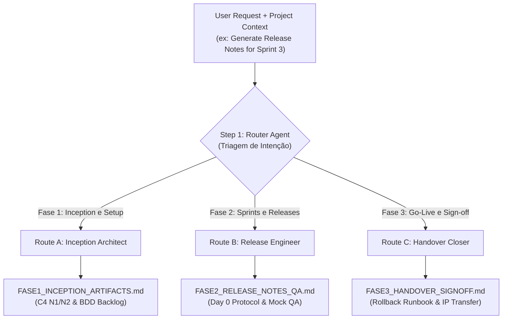

<div align="center">

# Technical Delivery Engine Plugin
### Event-Driven Router Pipeline for Software Engineering Artifacts & Handover

[](https://antigravity.google)
[](#4-event-driven-router-architecture)
[](./LICENSE)
[](#2-the-3-phases-of-technical-delivery)

<p align="center">
  <b>Generate hyper-specialized engineering artifacts on-demand—from C4 Models to Release Notes and Handover Sign-offs—while seamlessly enforcing contractual protections (Mocks, SLAs, and IP Transfer).</b>
</p>

</div>

---

## 1. Strategic Mission: The "Bloco 2" Execution Engine

If the **Contract Annexes Engine** builds the legal shields, the **Technical Delivery Engine** is the machinery that makes those shields work in the trenches.

This plugin ensures that the engineering team delivers professional, highly standardized artifacts throughout the software development lifecycle. By treating engineering documentation as an event-driven flow, we eliminate "zombie projects" and unstructured communication, ensuring the client receives what they paid for while the software house remains protected against undue liability.

---

## 2. The 3 Phases of Technical Delivery

Because delivery artifacts are generated months apart, this plugin organizes them into three distinct temporal phases:

### Phase 1: Inception & Setup Estrutural (Sprint 0 / M0)
- **Artifacts:** C4 Model Diagrams (Context N1 & Containers N2 in Mermaid), Infrastructure & RACI Matrix, CI/CD Pipeline Setup with Staging Health Check, and Refined Sprint 1 Backlog with BDD Acceptance Criteria.
- **Goal:** Materialize the architectural baseline and prove to the client's CTO that the foundation is sound before business logic is written, establishing clear Schedule Freeze triggers.

### Phase 2: Construção, QA & Entrega Contínua (Sprints / Marcos M1..Mn)
- **Artifacts:** Formal UAT Protocol (Day 0 trigger for the 5-day Tacit Acceptance Window), Release Notes (with explicit Known Issues), OpenAPI/Swagger specs with executable cURLs, and QA Reports.
- **Goal:** Formally trigger the **5-day Tacit Acceptance Window**. Crucially, this phase demands evidence of mock-based CI/CD testing, proving the software house's deliverables work independently of the client's legacy system stability.

### Phase 3: Go-Live & Handover Técnico (Encerramento)
- **Artifacts:** Production Runbook (with step-by-step Rollback), Technical Debt Matrix (Handover Report converting scope into AMS opportunities), and the Formal Sign-off Term with IP Release.
- **Goal:** Execute a clean project closure. The sign-off explicitly conditions the transfer of **Foreground IP** to 100% financial settlement, establishes the 60-day corrective warranty timeline, and includes formal signatures with witnesses.

---

## 3. Directory Structure (100% Antigravity Compliant)

```text
technical-delivery-engine-plugin/
├── plugin.json
├── README.md
├── LICENSE
├── .gitignore
├── rules/
│   ├── delivery-quality-standards.md
│   └── handover-legal-safeguards.md
├── skills/
│   └── technical-delivery-router/
│       ├── SKILL.md
│       └── templates/
│           ├── FASE1_INCEPTION_ARTIFACTS.template.md
│           ├── FASE2_RELEASE_NOTES_QA.template.md
│           └── FASE3_HANDOVER_SIGNOFF.template.md
└── agents/
    ├── phase1-inception-architect.md
    ├── phase2-release-engineer.md
    └── phase3-handover-closer.md
```

---

## 4. Event-Driven Router Architecture

Unlike monolithic pipelines or Directed Acyclic Graphs (DAGs) that execute all tasks sequentially, this plugin implements a **Router/Dispatcher** pattern. The Orchestrator Skill evaluates the user's intent and routes the request exclusively to the specialized agent for that phase, saving token context and ensuring hyper-focus.



---

## 5. Installation & Usage

### 5.1 Global Installation

```bash
mkdir -p ~/.gemini/config/plugins/technical-delivery-engine-plugin
cp -r ./* ~/.gemini/config/plugins/technical-delivery-engine-plugin/
```

### 5.2 Command Invocation

Invoque o comando oficial da skill orquestradora:

```bash
# Triagem automática com base no pedido:
/technical-delivery-router auto [caminho_contexto] [output_dir]

# Forçar Fase 1 (Arquitetura e Setup Estrutural):
/technical-delivery-router fase1 [caminho_sow_ou_dossie] [output_dir]

# Forçar Fase 2 (Release Notes, Protocolo de Homologação e QA):
/technical-delivery-router fase2 [caminho_dados_release] [output_dir]

# Forçar Fase 3 (Go-Live, Runbook e Sign-off Jurídico):
/technical-delivery-router fase3 [caminho_dados_encerramento] [output_dir]
```

*Por padrão, se `[output_dir]` não for informado, os artefatos serão gerados em `./artefatos_delivery/`.*

---

## 6. License & Credits

* **Author:** Engineering Architecture Office / HalcyonTech-LTDA
* **Organization:** [HalcyonTech-LTDA](https://github.com/HalcyonTech-LTDA)
* **License:** [MIT](./LICENSE)
